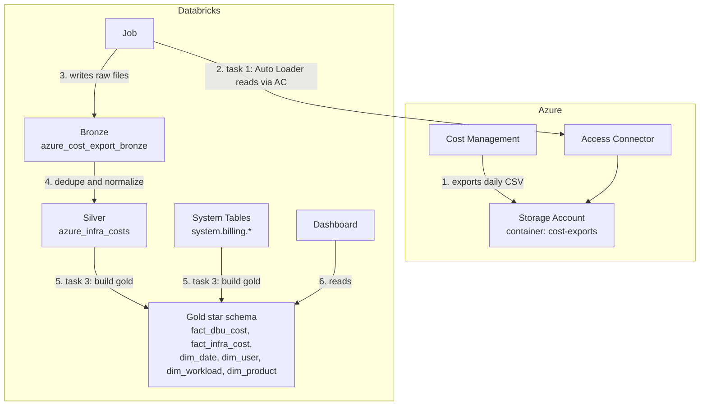

# Controlling Databricks Costs on Azure, Part 2: Building the Cost Dashboard
In [Part 1](../2026-07-26-azure-databricks-cost-control/index.md), I compared unexpected cloud costs to a surprise restaurant bill. An itemized bill helps you understand what you ordered and spot a bottle of wine that might belong to another table. A cost dashboard does something similar: it breaks down spending so you can investigate unexpected charges.

That visibility is the starting point for meaningful alerts and budgets. In this post, we'll build a dashboard and explore:

- Which dashboarding options exist on Azure and inside Databricks, and where each one fits
- How to move the built-in usage dashboard from ClickOps to Terraform
- How we bring Azure infrastructure costs into the same dashboard
- Which Azure cost export type to choose: actual, amortized or FOCUS
- Who should get `CAN_RUN` on the dashboard, and when that is risky

<!-- truncate -->

---

## Recap: Why Visibility First

As explained in Part 1, classic compute has DBU charges and separate Azure VM costs. Serverless pricing includes the underlying compute; storage and networking can still add costs. We use Azure Cost Management for infrastructure costs and Databricks System Tables for detailed Databricks usage. We wanted to see both in one dashboard.

## Option A: Azure-Native Monitoring

Azure offers several monitoring options, including Cost Management, dashboards, Monitor workbooks and Managed Grafana. They can be set up with Terraform and are a convenient starting point for teams already using Azure.

Azure Cost Management breaks costs down by scope and service, but it does not provide the same job- and user-level detail as Databricks System Tables. It is useful for an initial view, but not enough for our workload analysis.

## Option B: Monitor Costs in Databricks

### Why Option B

Databricks System Tables help us connect usage to workloads and, where available, users. That makes it easier to investigate a cost increase.

Our dashboard should answer three questions:

| Question | Why it matters |
| --- | --- |
| How does spending compare to the previous 30 days? | Spot changes in DBU and infrastructure costs. |
| What are the top 10 cost drivers? | Find the workloads and infrastructure items worth investigating. |
| Which users generate the most cost, when, and with which features? | Identify owners and start a conversation about usage. |

The dashboard shows DBU list costs and Azure infrastructure costs separately. User and workload details come from System Tables; Azure infrastructure costs need an additional pipeline.

### Setup Options

**ClickOps (not recommended for ongoing management).** An account admin can import the ready-made [usage dashboard](https://learn.microsoft.com/en-us/azure/databricks/admin/account-settings/usage) from the account console. It is useful for exploration, but has drawbacks:

- Not reproducible across environments
- No review, no history, manual drift
- No Azure infrastructure cost

**Infrastructure as Code, for example Terraform (recommended).** Configuration is reproducible and changes can be reviewed in pull requests.

Our workflow combines both:

1. Explore with the one-click dashboard
2. Remove unused visualizations in the UI
3. Export the dashboard as JSON and commit it
4. Provision it with Terraform

### Setup Overview

| Component | Purpose |
| --- | --- |
| System Tables | DBU usage and list prices |
| Azure Cost Management export | Daily CSV of actual Azure cost |
| Storage account (ADLS Gen2) | Landing zone for the CSV files |
| Access Connector, storage credential, external location | Secret-free access from Databricks to the storage account |
| Catalog and two schemas | Unity Catalog home: `finops` for bronze and silver, `finops_gold` for gold |
| Notebooks and job | Daily ingestion with Auto Loader, then the gold build |
| Bronze `azure_cost_export_bronze` | Raw export files, every version kept |
| Silver `azure_infra_costs` | Deduplicated, normalized Azure cost |
| Gold fact and dimension tables | Star schema over system tables and silver. The only thing the dashboard reads |
| AI/BI dashboard | Combines DBU and infrastructure cost from gold |

The pipeline uses three layers (medallion architecture):

- **Bronze:** raw export data.
- **Silver:** deduplicated and normalized data, filtered to relevant resource groups.
- **Gold:** a star schema for dashboard queries, with price joins and workload logic.

The gold build reads `system.billing.*` directly; we do not copy it into bronze or silver.



### Step-by-Step Setup

**Prerequisites:** an Azure Databricks workspace with Unity Catalog and the `system.billing` schema enabled. The example creates a small serverless SQL warehouse for the dashboard, or reuses one you pass as `warehouse_id`.

#### Step 1: Export Azure cost to a storage account

We export Azure Cost Management data daily to include infrastructure costs.

```hcl
resource "azurerm_storage_account" "costs" {
  name                     = var.storage_account_name
  resource_group_name      = azurerm_resource_group.finops.name
  location                 = azurerm_resource_group.finops.location
  account_tier             = "Standard"
  account_replication_type = "LRS"
  is_hns_enabled           = true # ADLS Gen2, required for abfss://
}

resource "azurerm_storage_container" "costs" {
  name               = "cost-exports"
  storage_account_id = azurerm_storage_account.costs.id
}

resource "azurerm_subscription_cost_management_export" "daily" {
  name                         = "databricks-daily-cost"
  subscription_id              = data.azurerm_subscription.current.id
  recurrence_type              = "Daily"
  recurrence_period_start_date = "2026-08-01T00:00:00Z"
  recurrence_period_end_date   = "2027-08-01T00:00:00Z"
  file_format                  = "Csv"

  export_data_storage_location {
    container_id     = azurerm_storage_container.costs.id
    root_folder_path = "/exports"
  }

  export_data_options {
    type       = "ActualCost"
    time_frame = "MonthToDate"
  }
}
```

Azure writes a month-to-date CSV each day. Because reports can be updated or corrected, ingestion in step 5 handles overlapping exports. The first files can take up to 24 hours.

The `Microsoft.CostManagementExports` resource provider must be registered on the subscription.

##### Which export type?

Azure offers three export types. They show the same cost from different angles:

| Type | What it shows | Use it when |
| --- | --- | --- |
| `ActualCost` | Cost as it appears on the invoice. A reservation or prepurchase appears in full on the day you buy it. | You want to match the invoice. |
| `AmortizedCost` | Upfront purchases spread over their term, for example a one-year reservation spread across every day. | You use reservations, savings plans or a Databricks prepurchase (DBCU) and want a smooth daily cost. |
| `FocusCost` | Both views in one file, in the open [FOCUS](https://focus.finops.org/) standard: `BilledCost` (actual) and `EffectiveCost` (amortized). | You start fresh. |

Actual cost helps reconcile invoices; amortized cost helps understand the ongoing cost of reservations and other commitments.

Where available, I recommend `FocusCost`:

- It provides both views in one export. A dashboard can switch between them with `CASE WHEN :cost_type = 'amortized' THEN EffectiveCost ELSE BilledCost END`.
- Its standardized columns reduce the normalization needed in step 5.

FOCUS exports are supported for EA and MCA billing accounts only. Classic MOSP subscriptions (pay-as-you-go, Visual Studio/MSDN benefits) don't offer the `FOCUS` dataset. That is why the example uses ActualCost.

#### Step 2: Give Databricks access to the storage

An Access Connector with a managed identity replaces storage keys. Unity Catalog uses it through a storage credential and an external location.

```hcl
resource "azurerm_databricks_access_connector" "costs" {
  name                = "ac-databricks-finops"
  resource_group_name = azurerm_resource_group.finops.name
  location            = azurerm_resource_group.finops.location

  identity {
    type = "SystemAssigned"
  }
}

resource "azurerm_role_assignment" "costs" {
  scope                = azurerm_storage_account.costs.id
  role_definition_name = "Storage Blob Data Contributor"
  principal_id         = azurerm_databricks_access_connector.costs.identity[0].principal_id
}

resource "databricks_storage_credential" "costs" {
  name = "azure_cost_export"
  azure_managed_identity {
    access_connector_id = azurerm_databricks_access_connector.costs.id
  }
  depends_on = [azurerm_role_assignment.costs]
}

resource "databricks_external_location" "cost_exports" {
  name            = "azure_cost_exports"
  url             = "abfss://cost-exports@${azurerm_storage_account.costs.name}.dfs.core.windows.net"
  credential_name = databricks_storage_credential.costs.id
}
```

The managed identity gets read and write access to the storage account, without a storage key to manage.

#### Step 3: Create catalog and schema

```hcl
resource "databricks_catalog" "finops" {
  name         = var.catalog_name
  storage_root = "${databricks_external_location.cost_exports.url}/catalogs/${var.catalog_name}"
}

resource "databricks_schema" "finops" {
  catalog_name = databricks_catalog.finops.name
  name         = var.schema_name # bronze and silver
}

resource "databricks_schema" "gold" {
  catalog_name = databricks_catalog.finops.name
  name         = var.gold_schema_name # gold
}
```

Bronze and silver share `finops`; gold has its own schema. You can also use one schema per layer. Separating gold lets dashboard viewers access it without access to the raw exports.

#### Step 4: Upload the notebooks and the Python package

The tested `finops_costs` Python package contains the transformation logic. Each notebook reads parameters, calls the package and writes a table.

```hcl
resource "databricks_directory" "modules" {
  # Workspace files do not create missing parent folders, unlike notebooks.
  path = "${var.dashboard_parent_path}/finops_costs"
}

resource "databricks_workspace_file" "modules" {
  for_each = fileset("${path.module}/../src/finops_costs", "*.py")

  path   = "${databricks_directory.modules.path}/${each.value}"
  source = "${path.module}/../src/finops_costs/${each.value}"
}

resource "databricks_notebook" "ingest_costs" {
  path   = "${var.dashboard_parent_path}/ingest_azure_costs"
  source = "${path.module}/../notebooks/ingest_azure_costs.py"
}

resource "databricks_notebook" "build_silver" {
  path   = "${var.dashboard_parent_path}/build_silver"
  source = "${path.module}/../notebooks/build_silver.py"
}

resource "databricks_notebook" "build_gold" {
  path   = "${var.dashboard_parent_path}/build_gold"
  source = "${path.module}/../notebooks/build_gold.py"
}
```

What happens:

- `databricks_directory` creates the package folder; workspace files cannot create missing parent folders.
- `fileset` uploads all `.py` modules, including new ones, without a Terraform change.
- The three notebooks are the job's entry points, one per layer.
- The notebooks use `module_root` (for example `/Workspace/Shared/finops`) to import the package through `sys.path`, without installing a wheel.
- The next `terraform apply` uploads changed notebooks and modules.

#### Step 5: Ingest the export with a job

The job runs one task per layer. Each task can retry independently, and a repair run can restart at the failed layer. It uses serverless environment version 5 (Python 3.12, Spark 4.1, Databricks Runtime 18.x):

```hcl
resource "databricks_job" "ingest_costs" {
  name = "Ingest Azure infrastructure costs"

  environment {
    environment_key = "v5"

    spec {
      environment_version = "5"
    }
  }

  schedule {
    quartz_cron_expression = "0 0 6 * * ?"
    timezone_id            = "Europe/Zurich"
  }

  task {
    task_key        = "ingest_azure_costs"
    environment_key = "v5"
    max_retries     = 2

    notebook_task {
      notebook_path = databricks_notebook.ingest_costs.path
      base_parameters = {
        catalog_name = var.catalog_name
        schema_name  = var.schema_name
        source_path  = "${databricks_external_location.cost_exports.url}/exports"
        state_path   = "${databricks_external_location.cost_exports.url}/_databricks_state"
      }
    }
  }

  task {
    task_key        = "build_silver"
    environment_key = "v5"
    max_retries     = 2

    depends_on {
      task_key = "ingest_azure_costs"
    }

    notebook_task {
      notebook_path = databricks_notebook.build_silver.path
      base_parameters = {
        catalog_name    = var.catalog_name
        schema_name     = var.schema_name
        resource_groups = join(",", var.databricks_resource_group_names)
        module_root     = "/Workspace/Shared/finops"
      }
    }
  }
}
```

What happens on every run:

1. **Bronze:** Auto Loader appends new or overwritten file versions to `azure_cost_export_bronze`.
2. **Silver:** It keeps the latest complete export per billing period to avoid counting overlapping month-to-date reports twice. It removes duplicate rows, normalizes columns across EA, MCA and pay-as-you-go exports, and filters resource groups.
3. Silver replaces `azure_infra_costs` with the result. The gold task follows in step 6.

In Spark 4.1 ANSI mode, malformed values can fail the job. The silver code uses `try_cast` and `try_to_date` to return NULL instead; a unit test covers this case.

The resource group filter must include each workspace's managed resource group. Otherwise the VMs are missing.

Two details caused an empty infrastructure chart: Azure escapes quotes in the JSON `Tags` column as `""`, so Auto Loader needs `escape = '"'` to avoid shifting columns. Pay-as-you-go exports use `PreTaxCost` in the billing currency, not `CostInUsd`.

#### Step 6: Build the gold layer

The job gets a third task that runs after silver:

```hcl
  task {
    task_key        = "build_gold"
    environment_key = "v5"

    depends_on {
      task_key = "build_silver"
    }

    notebook_task {
      notebook_path = databricks_notebook.build_gold.path
      base_parameters = {
        catalog_name     = var.catalog_name
        schema_name      = var.schema_name
        gold_schema_name = var.gold_schema_name
      }
    }
  }
```

The notebook builds a star schema with separate fact tables. Both have a date, but Azure infrastructure cost is not attributed to a Databricks user or job.

| Table | Grain | Content |
| --- | --- | --- |
| `fact_dbu_cost` | day, workspace, user, workload, product, SKU | DBU quantity and list cost in USD |
| `fact_infra_cost` | day, resource group, meter category, billing currency | Azure actual cost in the billing currency (for us CHF) |
| `dim_date` | day | week, month, year, day name |
| `dim_user` | user | user, service principal or unattributed |
| `dim_workload` | workload | job, SQL warehouse, pipeline, serving endpoint or cluster, with a readable name |
| `dim_product` | product and SKU | Databricks feature, for example `JOBS` or `SQL` |

Workspace, resource group and meter category remain in the fact tables rather than separate dimensions.

The list price join and the workload logic exist exactly once:

```sql
SELECT
  u.usage_date,
  u.workspace_id,
  COALESCE(u.identity_metadata.run_as, u.identity_metadata.owned_by, 'unattributed') AS user_name,
  CONCAT(<workload type>, ':', <workload id>) AS workload_key,
  u.billing_origin_product AS product,
  u.sku_name,
  SUM(u.usage_quantity) AS usage_quantity,
  SUM(u.usage_quantity * lp.pricing.default) AS list_cost_usd
FROM system.billing.usage AS u
JOIN system.billing.list_prices AS lp
  ON u.sku_name = lp.sku_name
  AND u.cloud = lp.cloud
  AND u.usage_start_time >= lp.price_start_time
  AND (lp.price_end_time IS NULL OR u.usage_start_time < lp.price_end_time)
GROUP BY ALL;
```

The workload type is the first non-empty identifier: job, SQL warehouse, pipeline, serving endpoint, cluster.

The job identity needs read access to `system.billing`:

```hcl
data "databricks_current_user" "me" {}

locals {
  system_tables_reader = coalesce(var.system_tables_reader, data.databricks_current_user.me.user_name)
}

resource "databricks_grant" "system_catalog" {
  catalog    = "system"
  principal  = local.system_tables_reader
  privileges = ["USE_CATALOG"]
}

resource "databricks_grant" "system_billing" {
  schema     = "system.billing"
  principal  = local.system_tables_reader
  privileges = ["USE_SCHEMA", "SELECT"]
}
```

What happens:

- `system_tables_reader` defaults to the Terraform identity. Set it if the job runs as another user or service principal (application ID).
- `USE_CATALOG` and `USE_SCHEMA` provide access to the path; `SELECT` allows reading `usage` and `list_prices`.
- `databricks_grant` manages this principal only. Unlike `databricks_grants`, it leaves other principals' grants untouched.
- Granting on the `system` catalog requires `MANAGE`. If Terraform does not run as a metastore admin, an admin can run the two SQL `GRANT` statements instead.

#### Step 7: Provision the dashboard

The dashboard is the exported JSON from our UI iteration. Terraform replaces the catalog and gold schema names with a template.

```hcl
resource "databricks_dashboard" "cost" {
  display_name      = "Azure Databricks Cost Dashboard"
  warehouse_id      = coalesce(var.warehouse_id, one(databricks_sql_endpoint.dashboard[*].id))
  parent_path       = "/Workspace/Shared/finops"
  embed_credentials = false

  serialized_dashboard = templatefile("${path.module}/dashboards/cost_dashboard.lvdash.json.tftpl", {
    catalog_name     = var.catalog_name
    gold_schema_name = var.gold_schema_name
  })
}
```

With `embed_credentials = false`, viewers use their own permissions. They need access to the warehouse and gold tables, but not to `system.billing`, bronze or silver.

##### Who gets access: `CAN_RUN`

Dashboard viewers also need dashboard permissions. `CAN_RUN` lets them open, filter and refresh the dashboard without editing, publishing or sharing it. Keep edit and manage rights with the team maintaining the JSON. According to the [Databricks ACL table](https://learn.microsoft.com/en-us/azure/databricks/security/auth/access-control/#dashboard-acls), `CAN_READ` (CAN VIEW in the UI) currently grants the same dashboard abilities.

Grant it to a group, not to individual users:

```hcl
resource "databricks_permissions" "cost_dashboard" {
  dashboard_id = databricks_dashboard.cost.id

  access_control {
    group_name       = "finops-viewers"
    permission_level = "CAN_RUN"
  }
}
```

What `CAN_RUN` actually allows depends on `embed_credentials`:

| | `embed_credentials = false` | `embed_credentials = true` |
| --- | --- | --- |
| Queries run as | the viewer | the publisher |
| Viewer needs | `CAN_USE` on the warehouse, `SELECT` on gold | only `CAN_RUN` |
| Viewer sees | what Unity Catalog allows them to see | everything the dashboard queries can read with the publisher's rights |

Embedded credentials require care: viewers can see query results using the publisher's rights. If queries read `system.billing` directly, they can expose spending across workspaces and users without giving viewers direct table access. If you embed credentials, use a service principal with access limited to the required gold data.

The daily cost query shows both facts side by side. Each source keeps its own currency, so the chart groups the bars instead of stacking them:

```sql
SELECT usage_date, 'Databricks DBU list cost (USD)' AS cost_source, SUM(list_cost_usd) AS cost
FROM finops_gold.fact_dbu_cost
GROUP BY ALL
UNION ALL
SELECT usage_date, CONCAT('Azure infrastructure actual cost (', billing_currency, ')'), SUM(cost_in_billing_currency)
FROM finops_gold.fact_infra_cost
GROUP BY ALL;
```

#### The three dashboard questions

The dashboard uses these datasets to answer the three questions:

| Question | Dataset (gold tables) | Visualization |
| --- | --- | --- |
| Spending vs. previous 30 days | `period_totals`, `period_comparison` (both facts) | Four counters (DBU in USD and Azure infrastructure in CHF, each with change in %) and a bar chart by period and source |
| Top 10 cost drivers | `top_workloads` (`fact_dbu_cost` + `dim_workload`), `top_infra_drivers` (`fact_infra_cost`) | Two ranked bar charts: Databricks workloads (DBU) and Azure infrastructure (resource group and meter category) |
| Users, period, features | `user_cost` (`fact_dbu_cost` + `dim_date`) | Bar chart per user stacked by product, and bar chart per user by week |

For the comparison, both windows cover 30 full days. Today is excluded, because a partial day would distort the change:

```sql
SELECT
  CASE WHEN usage_date >= current_date() - INTERVAL 30 DAYS
       THEN 'Last 30 days' ELSE 'Previous 30 days' END AS period,
  cost_source,
  SUM(cost) AS cost
FROM costs -- fact_dbu_cost UNION ALL fact_infra_cost, last 60 days
GROUP BY 1, 2;
```

For the top 10 workloads, the fact joins the workload dimension:

```sql
SELECT w.workload_name AS workload, SUM(f.list_cost_usd) AS cost_usd
FROM finops_gold.fact_dbu_cost AS f
LEFT JOIN finops_gold.dim_workload AS w ON f.workload_key = w.workload_key
WHERE f.usage_date >= current_date() - INTERVAL 30 DAYS
GROUP BY 1
ORDER BY cost_usd DESC
LIMIT 10;
```

The user dataset groups the top 10 users or service principals by week and product.

The infrastructure comparison is meaningful only when exports cover both periods. Initially, missing historical data can make the change look too high.

<!-- TODO: screenshot of the combined dashboard with Azure infra costs -->

#### Step 8: Run and verify

1. Run `terraform init`, `plan` and `apply`.
2. Run the Cost Management export once, or wait for the first schedule.
3. Run the job once. The bronze, silver and gold tasks run in order.
4. Open the dashboard and compare totals per resource group with Azure Cost Management.

Two limits to communicate early:

- Azure data is exported daily, which is enough for our sprint-based review.
- The dashboard shows DBU list costs in USD and Azure actual costs in the billing currency (CHF for us) side by side; it does not add them together.

The gold tables can also support alerts, reports and ad-hoc analysis without repeating the price joins.

## Lessons Learned

- **Start where your team is.** Azure Cost Management and Databricks dashboards can also be used separately. We combined them when we needed more detail.
- **Trim the template.** Remove visualizations nobody uses so the dashboard stays useful.
- **List price ≠ invoice.** Make the distinction clear before comparing dashboard figures with the invoice.
- **Keep JSON in version control.** Export-and-commit makes dashboard changes reviewable and repeatable.

## What's Next

The dashboard provides visibility. The next posts cover the other two building blocks:

- [Part 3: Proactive Alerts with SQL Alerts](../2026-08-08-azure-databricks-cost-control-alerts/index.md): our median-based threshold logic on System Tables, Terraform setup, and how we keep alert fatigue under control
- [Part 4: Budget Control & Spend Blocking](../2026-08-15-azure-databricks-cost-control-budget/index.md): budgets per user and group, spend blocking for Genie, and the series wrap-up

## Further Reading

**Databricks:**

- [Billable usage system tables](https://learn.microsoft.com/en-us/azure/databricks/admin/system-tables/billing): schema reference for `system.billing.usage` and `system.billing.list_prices`
- [Monitor account usage](https://learn.microsoft.com/en-us/azure/databricks/admin/account-settings/usage): the built-in usage dashboard this post builds on
- [Dashboards](https://learn.microsoft.com/en-us/azure/databricks/dashboards/): creating, exporting, and managing Databricks dashboards
- [Cost optimization best practices](https://learn.microsoft.com/en-us/azure/databricks/lakehouse-architecture/cost-optimization/best-practices): the Lakehouse Well-Architected cost optimization pillar

**Microsoft:**

- [Azure Well-Architected Framework – Cost Optimization](https://learn.microsoft.com/en-us/azure/well-architected/cost-optimization/): the principles behind cost visibility as a first step
- [Tutorial: Create and manage exported data](https://learn.microsoft.com/en-us/azure/cost-management-billing/costs/tutorial-improved-exports): setting up the Azure Cost Management export used in our pipeline
- [Azure Cost Management best practices](https://learn.microsoft.com/en-us/azure/cost-management-billing/costs/cost-mgt-best-practices): practical guidance for the Azure side of the picture

If you have built something similar, I would love to hear what worked for you. I am especially curious how you handle the gap between list prices and actual invoice amounts.
