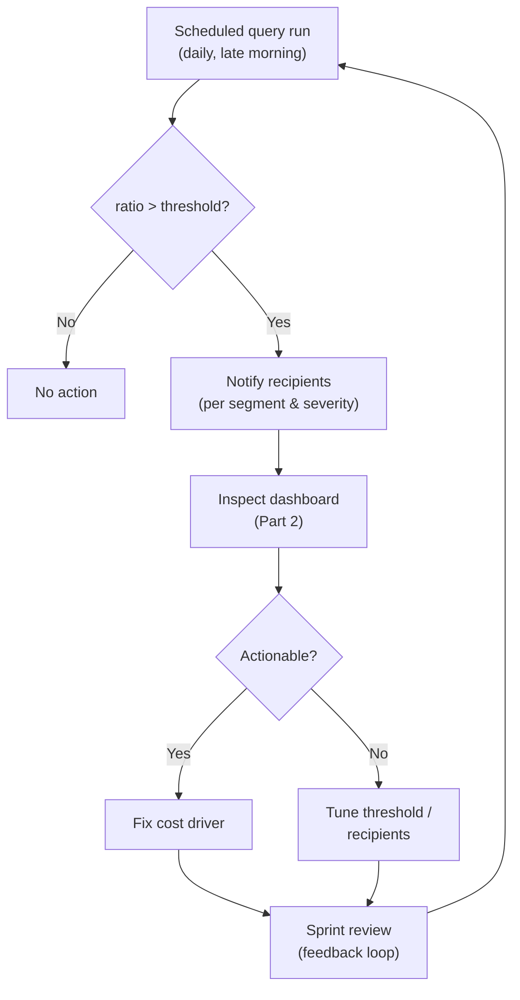

# Controlling Databricks Costs on Azure, Part 3: Proactive Alerts with SQL Alerts

In [Part 1](../2026-07-26-azure-databricks-cost-control/index.md) I laid out our three building blocks for Databricks cost control: dashboards for visibility, SQL alerts for proactive management, and Budget Control for governance. [Part 2](../2026-08-01-azure-databricks-cost-control-dashboard/index.md) covered the dashboard. Now for the part that actually wakes us up when something goes wrong: SQL alerts.

In this post, you'll learn:

- Why a great dashboard still leaves you reactive
- The exact query behind our "yesterday above the 30-day median" alert, including segmentation by sandbox vs. production
- How to provision queries and alerts with Terraform
- How we design thresholds and keep alert fatigue under control

<!-- truncate -->

---

## Why Dashboards Alone Are Not Enough

The dashboard from Part 2 gives us facts instead of intuition. But only if someone looks at it. Our sprint-based cost review catches trends, not incidents. A runaway job that starts on Monday can burn budget for two weeks before the next review. That is the fundamental limitation of any dashboard: it is reactive by design.

Alerts flip this around. Instead of us checking the data, the data checks on us. The goal is simple: when spend deviates from normal, we want to know within a day, not at the end of the sprint.

## The Alert Logic: Yesterday vs. the 30-Day Median

As described in Part 1, our main alert triggers when yesterday's cost is above the median of the last 30 days. Why the median and not the mean? Because cost data is spiky, and a single expensive day would drag the mean up and mask the next incident. The median stays stable.

Here is the core query, again based on `system.billing.usage` joined with `system.billing.list_prices` (same caveat as in Part 2: these are list prices, not your negotiated invoice amounts):

```sql
WITH daily_cost AS (
  SELECT
    u.usage_date,
    SUM(u.usage_quantity * lp.pricing.default) AS cost_usd
  FROM system.billing.usage AS u
  JOIN system.billing.list_prices AS lp
    ON u.sku_name = lp.sku_name
    AND u.cloud = lp.cloud
    AND u.usage_start_time >= lp.price_start_time
    AND (lp.price_end_time IS NULL OR u.usage_start_time < lp.price_end_time)
  WHERE u.usage_date >= current_date() - INTERVAL 31 DAYS
    AND u.usage_date < current_date()
  GROUP BY u.usage_date
)
SELECT
  MAX(CASE WHEN usage_date = current_date() - INTERVAL 1 DAY
      THEN cost_usd END) AS yesterday_cost,
  median(CASE WHEN usage_date < current_date() - INTERVAL 1 DAY
      THEN cost_usd END) AS median_30d,
  MAX(CASE WHEN usage_date = current_date() - INTERVAL 1 DAY
      THEN cost_usd END)
    / median(CASE WHEN usage_date < current_date() - INTERVAL 1 DAY
      THEN cost_usd END) AS ratio
FROM daily_cost
```

The alert condition then checks the `ratio` column. For example, fire when it exceeds `1.5`. We deliberately alert on a *ratio* rather than an absolute amount: the same alert definition works for a $50/day sandbox and a $5,000/day production workspace.

### Segmenting Sandbox vs. Production

One global alert is too blunt. A spike in the sandbox means something very different from a spike in production. We segment by workspace type using the workspace ID (a tag- or name-based mapping works too, depending on your setup):

```sql
WITH daily_cost AS (
  SELECT
    u.usage_date,
    CASE
      WHEN u.workspace_id IN (/* sandbox workspace IDs */) THEN 'sandbox'
      ELSE 'production'
    END AS segment,
    SUM(u.usage_quantity * lp.pricing.default) AS cost_usd
  FROM system.billing.usage AS u
  JOIN system.billing.list_prices AS lp
    ON u.sku_name = lp.sku_name
    AND u.cloud = lp.cloud
    AND u.usage_start_time >= lp.price_start_time
    AND (lp.price_end_time IS NULL OR u.usage_start_time < lp.price_end_time)
  WHERE u.usage_date >= current_date() - INTERVAL 31 DAYS
    AND u.usage_date < current_date()
  GROUP BY u.usage_date, segment
)
SELECT
  segment,
  MAX(CASE WHEN usage_date = current_date() - INTERVAL 1 DAY
      THEN cost_usd END) AS yesterday_cost,
  median(CASE WHEN usage_date < current_date() - INTERVAL 1 DAY
      THEN cost_usd END) AS median_30d
FROM daily_cost
GROUP BY segment
```

We run one alert per segment with different sensitivity: the sandbox alert is more tolerant (people are supposed to experiment there), the production alert is stricter. The same pattern extends to environments (dev/test/prod). Just swap the `CASE` expression.

## Provisioning with Terraform

Alerts, like dashboards, must not live as ClickOps. The Databricks Terraform provider covers both the query and the alert. Here is a simplified example. It is illustrative, so check the current provider documentation, as the query and alert resources have been reworked across provider versions:

```hcl
resource "databricks_query" "daily_cost_check" {
  display_name = "Daily cost vs. 30-day median (production)"
  warehouse_id = databricks_sql_endpoint.monitoring.id
  parent_path  = "/Workspace/Shared/finops/alerts"
  query_text   = file("${path.module}/queries/daily_cost_check.sql")
}

resource "databricks_alert" "daily_cost_alert" {
  display_name = "Production cost above 30-day median"
  query_id     = databricks_query.daily_cost_check.id
  parent_path  = "/Workspace/Shared/finops/alerts"

  condition {
    op = "GREATER_THAN"

    operand {
      column {
        name = "ratio"
      }
    }

    threshold {
      value {
        double_value = 1.5
      }
    }
  }
}
```

The schedule (how often the query runs and the alert is evaluated) and the notification destinations are configured alongside. We run the check once per day in the morning, since `system.billing.usage` data can lag by a few hours and yesterday's data needs to be complete.

<!-- TODO: screenshot of a triggered alert in the Databricks UI -->

## Threshold Design and Alert Fatigue

The hard part of alerting is not the SQL. It is the tuning. As covered in Part 1, an ignored alert is worse than no alert: it creates false confidence. Our defenses:

- **Start insensitive, tighten later.** We launched with a ratio of 2.0 and lowered it step by step. Starting too sensitive burns trust in week one, and trust is hard to win back.
- **Team review cadence.** Every few sprints, we review all triggered alerts: which were actionable, which were noise? Based on that, we adjust thresholds, frequency, and recipients, and consolidate or disable alerts. This is the same feedback loop described in Part 1. It sounds bureaucratic, but takes 15 minutes and is the single most effective measure against fatigue.
- **The multi-threshold workaround.** Unlike Azure Budgets, Databricks SQL alerts have no native "one budget, multiple notification thresholds" concept. If you want escalating notifications (say, informative at 80 percent, urgent at 100 percent), you create multiple alerts on the same query with different thresholds and different recipients. It works, but it multiplies the objects you maintain. One more reason everything lives in Terraform.



## Notification Channels

The default channel is email, and honestly: email is the weakest part of this setup. The messages are generic, easy to overlook, and land in the same inbox as everything else. What we do about it:

- Alert names carry the context (segment, severity) so the subject line alone tells you what is going on.
- Databricks supports notification destinations beyond email. A webhook into a Microsoft Teams channel is the obvious next step for us, so alerts land where the team already communicates. We have not fully rolled this out yet; I will share the setup once it has proven itself.

For user-specific notifications ("*you* exceeded *your* budget"), SQL alerts remain the wrong tool. They can detect that someone crossed a line, but cannot cleanly notify that person directly. That gap is exactly what Budget Control fills.

## Lessons Learned

- **Ratio beats absolute.** Alerting on "yesterday vs. median" made the same alert logic reusable across wildly different cost levels. It also survives natural growth without constant re-tuning.
- **The median was the right call.** After an expensive migration week, a mean-based alert would have gone silent for a month. The median barely moved.
- **Data latency is real.** Our first version ran too early in the morning and compared against incomplete data, producing false alarms. Now we evaluate late morning, and the false positives are gone.
- **Alerts are a product, not a setup task.** Without the review loop, our alert set would have quietly rotted. Treat thresholds as living configuration.

## What's Next

We can now see our costs (Part 2) and get notified when they deviate (this post). What is still missing is enforcement: stopping spend before it gets out of hand, per user and per group. That is Budget Control and spend blocking. It is the topic of [Part 4: Budget Control & Spend Blocking](../2026-08-15-azure-databricks-cost-control-budget/index.md), the final part of this series.

## Further Reading

**Databricks:**

- [Alerts on Databricks SQL](https://learn.microsoft.com/en-us/azure/databricks/sql/user/alerts/): official documentation for creating and configuring SQL alerts
- [Billable usage system tables](https://learn.microsoft.com/en-us/azure/databricks/admin/system-tables/billing): the `system.billing.usage` schema our alert queries build on
- [Cost optimization best practices](https://learn.microsoft.com/en-us/azure/databricks/lakehouse-architecture/cost-optimization/best-practices): the Lakehouse Well-Architected cost optimization pillar, including monitoring guidance
- [Lakehouse Well-Architected: Operational excellence](https://learn.microsoft.com/en-us/azure/databricks/lakehouse-architecture/operational-excellence/best-practices): where alerting and monitoring fit into a well-architected platform

**Microsoft:**

- [Azure Well-Architected Framework – Cost Optimization](https://learn.microsoft.com/en-us/azure/well-architected/cost-optimization/): design principles behind proactive cost monitoring
- [Azure Cost Management best practices](https://learn.microsoft.com/en-us/azure/cost-management-billing/costs/cost-mgt-best-practices): how Azure-native budgets and alerts complement this setup

If you run cost alerts on Databricks yourself: what threshold logic do you use, and how do you keep the noise down? I would love to compare notes.
