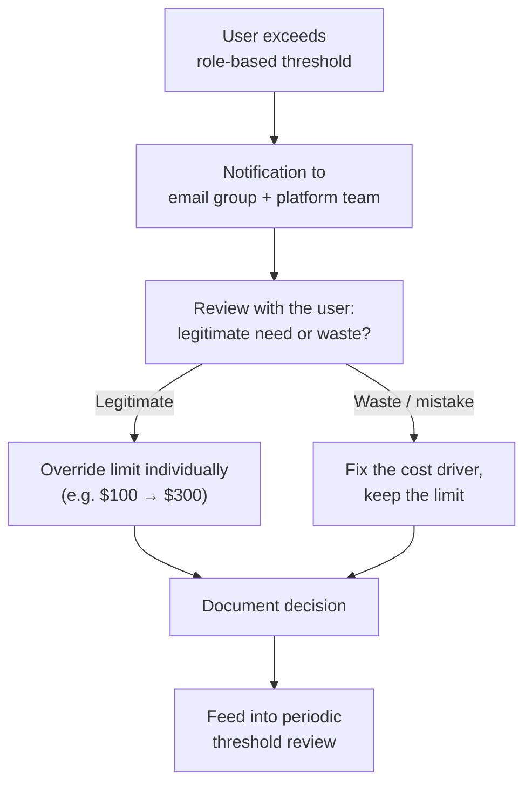

# Controlling Databricks Costs on Azure, Part 4: Budget Control & Spend Blocking

This is the final part of the series. [Part 1](../2026-07-26-azure-databricks-cost-control/index.md) compared the alternatives and explained our combined approach. [Part 2](../2026-08-01-azure-databricks-cost-control-dashboard/index.md) built the cost dashboard, and [Part 3](../2026-08-08-azure-databricks-cost-control-alerts/index.md) added proactive SQL alerts. One piece is still missing: enforcement. Dashboards show and alerts warn. Neither of them *stops* anything. That is the job of Budget Control.

In this post, you'll learn:

- What Budget Control (Public Preview) can and cannot do today
- How we set up budgets per user and user group, and how we derived role-based limits
- How spend blocking works (currently Genie only) and how our override process looks
- How we manage the ClickOps setup as documented technical debt until Terraform support catches up

<!-- truncate -->

---

## What Budget Control Is and Is Not

Budget Control is Databricks' newest cost-governance feature and, at the time of writing, still in Public Preview. The core idea: define a budget with a threshold and attach it to a scope (workspace, tags, user, or user group). When the threshold is crossed, you get an alert. In specific cases, you even get an actual spend block.

To be clear about the boundaries (all covered in more detail in Part 1):

- Alerting per user or user group works, but **only via UI setup**. Terraform support currently covers basic controls (grouping by workspace or day) only.
- Notifications go to a **predefined email group**, not directly to the individual user who exceeded the limit.
- **Spend blocking is limited to Genie** today. Everything else remains alert-only.
- Flexibility is limited to workspace and tags as dimensions.

Since features in Public Preview change quickly, treat the details in this post as a snapshot. Verify against the [current documentation](https://learn.microsoft.com/en-us/azure/databricks/admin/account-settings/budgets) before you build on them.

## Setting Up Budgets per User and Group

The setup itself happens in the account console UI. You define a budget and choose the scope: a single user, a user group, or a shared-user threshold that applies the same limit to every member of a group individually. Then you set the monthly amount and configure the notification target.

<!-- TODO: screenshot of the budget creation dialog in the account console -->

The more interesting question is: what should the limits be? We did not guess. We used the dashboard from Part 2 to review historical cost per user over several months and set initial values slightly above the typical monthly consumption per role. A limit that fires on day one for half the team is not governance, it is noise. The alert-fatigue lessons from Part 3 apply here too.

## Role-Based Budgets

With more than a handful of users, per-user budgets become a maintenance burden. Our answer, as outlined in Part 1, is budgets per user group aligned to roles:

| Role | Monthly threshold | Rationale |
| --- | --- | --- |
| Data engineers | $500 | Build and run pipelines, highest legitimate compute need |
| Data analysts | $300 | Mostly SQL warehouse usage, predictable patterns |
| Beta testers | Flexible, higher | Deliberately experiment with new (often serverless/AI) features |

These numbers are ours, not a recommendation. The point is the *pattern*: limits are agreed with the team based on responsibility and need, revisited when roles or workloads change, and transparent to everyone. When a group threshold is reached, the notification goes to the platform team **only**. This is the moment when the budget conversation happens. It's not about blaming, it's about understanding the usage, especially the usage of AI (Genie), and how it can be governed without limiting the users. 

## Spend Blocking and the Override Process

Alerts still rely on someone reacting. For the cases where we want a hard stop, Budget Control offers spend blocking. It currently works only for Genie, and I hope Databricks expands it to other workloads.

Our process when a block or threshold hits: we review the case together with the user. If the spend was legitimate, meaning a real workload that simply outgrew the initial estimate, we override the limit individually, for example from $100 to $300, and document why. If it was waste (a forgotten warehouse, an inefficient query pattern), we fix the cause and keep the limit. The override is deliberately a conversation, not a self-service button: that conversation is where cost awareness actually gets built.

:::info Why this matters right now

Genie became billable after July 31 (originally July 7, then postponed by Databricks). AI-assisted queries are exactly the kind of workload that quietly adds a new per-user cost stream. Every question a user asks Genie consumes billable compute. Per-user budgets with spend blocking are currently the only guardrail that can stop this automatically rather than just report it afterwards.

:::

## ClickOps as Documented Technical Debt

Regular readers know my stance: ClickOps, meaning manual configuration through the UI, does not belong in a professional setup. Yet our per-user and per-group budgets exist only through the UI, because Terraform support is not there yet. Rather than skip the feature, we accepted the debt consciously and made it manageable:

1. **A debt record in the backlog.** One ticket describes exactly which budgets exist, their scopes and thresholds, and links to this documentation. When Terraform support lands, this ticket becomes the migration task.
2. **Configuration documented next to the IaC.** A markdown file in the same repository as our Terraform code lists every manually created budget. It is not enforcement, but it prevents the "who created this and why?" archaeology later.
3. **Periodic drift check.** During the sprint cost review (Part 2), we verify that the UI state still matches the documented state. Manual, yes. But cheap, and it has already caught one budget someone adjusted without updating the doc.
4. **Watch the provider changelog.** Basic budget resources already exist in the Terraform provider; user/group scoping does not. We check release notes so we can migrate early instead of accumulating more manual state.

Is this elegant? No. But consciously managed debt beats either extreme: refusing a useful feature out of IaC purism, or letting an undocumented ClickOps landscape grow.

## Lessons Learned

- **Derive limits from data, not gut feeling.** The dashboard made the initial thresholds defensible and kept the discussions with the team short.
- **Group budgets scale, user budgets don't.** We keep individual budgets only for genuine exceptions; everything else is role-based.
- **The override conversation is the feature.** Every override review so far has either surfaced a real optimization or improved someone's understanding of what their workload costs. That is cost awareness in practice, not a slide deck.
- **Preview features need an exit plan.** Documenting the ClickOps state cost us an hour. It will save us days when the Terraform migration happens.

## Wrapping Up the Series

Four posts later, our cost control stack looks like this: the **dashboard** (Part 2) tells us what drives cost, **SQL alerts** (Part 3) tell us when spend deviates, and **Budget Control** (this post) enforces limits where they matter. Per user, per role, and for Genie even with a hard stop.

None of these pieces is impressive alone. A dashboard nobody opens, an alert everybody ignores, a budget without a review process: each fails individually. Together, and with the feedback loops around them, they deliver what we set out for in Part 1: no unexpected costs, cost awareness across all users, and processes the team can actually maintain.

Or, to close the loop from the very beginning of this series: we still enjoy going to the restaurant. We order what we need, we see the menu prices, and the waiter taps us on the shoulder before the third bottle. When the bill arrives, the only thing spicy about it is the food.

## Further Reading

**Databricks:**

- [Budgets & budget policies](https://learn.microsoft.com/en-us/azure/databricks/admin/account-settings/budgets): official documentation for Budget Control
- [Manage and monitor usage](https://learn.microsoft.com/en-us/azure/databricks/admin/usage/): the admin view on usage management, including spend limits
- [Cost optimization best practices](https://learn.microsoft.com/en-us/azure/databricks/lakehouse-architecture/cost-optimization/best-practices): governance guidance from the Lakehouse Well-Architected framework
- [Lakehouse Well-Architected framework](https://learn.microsoft.com/en-us/azure/databricks/lakehouse-architecture/): the full set of pillars this series aligns with

**Microsoft:**

- [Azure Well-Architected Framework – Cost Optimization](https://learn.microsoft.com/en-us/azure/well-architected/cost-optimization/): cost governance design principles
- [FinOps on Azure](https://learn.microsoft.com/en-us/cloud-computing/finops/overview): the FinOps framework behind accountability and cost awareness
- [Azure Cost Management best practices](https://learn.microsoft.com/en-us/azure/cost-management-billing/costs/cost-mgt-best-practices): budgets and governance on the Azure side

If you have followed along and built something similar, or something better, let me know. I am especially curious how others handle the preview-feature gap between what the UI offers and what IaC supports.
