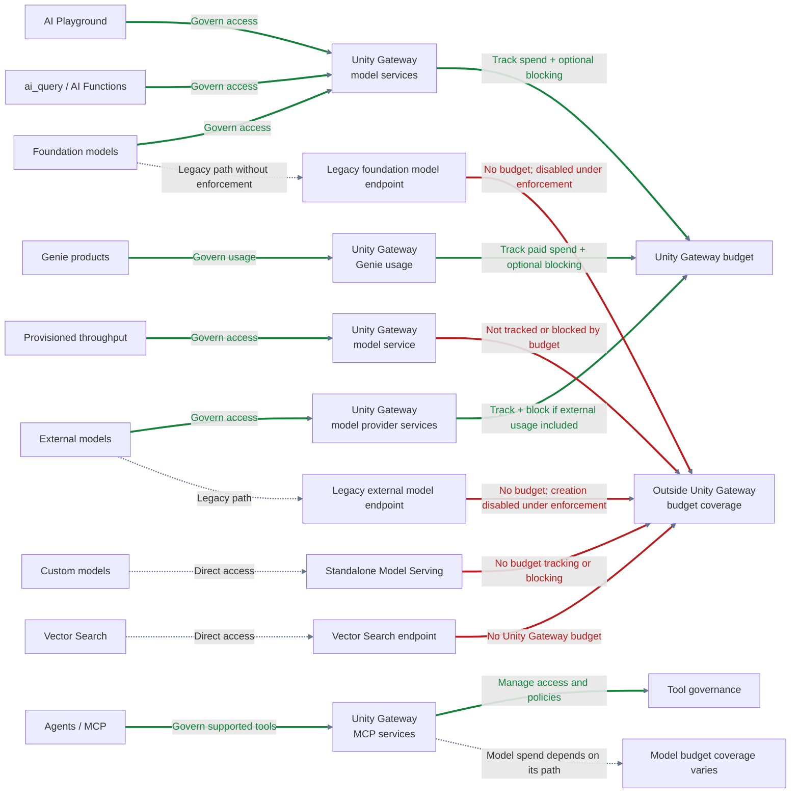

# AI Governance: Budget Control with Unity Gateway and Terraform

In [Part 4 of my Databricks cost control series](../2026-08-15-azure-databricks-cost-control-budget/index.md), we configured Genie budget controls manually because Terraform support was missing. With Databricks Terraform provider v1.128.0 and Unity Gateway, we can revisit that technical debt and apply budget controls to more AI usage paths.

<!-- truncate -->

## AI usage paths and guardrails

AI requests can use Unity Gateway, legacy endpoints, or direct services. **Green arrows** show available controls; **red arrows** show what the budget cannot cover or what enforcement disables. Grey dashed arrows show alternative access paths.



External model spend counts only when **Include external model usage** is enabled. Genie budgets apply to paid usage beyond the free allowance. See [Unity Gateway budgets](https://learn.microsoft.com/en-us/azure/databricks/ai-gateway/budgets) and [Genie budgets](https://learn.microsoft.com/en-us/azure/databricks/genie/budgets).

<!-- TODO: List the relevant AI usage paths, whether each supports alerts or blocking, and any prerequisites or exclusions. Verify the product name and terminology. -->

## Set up budget control with Terraform

The [Databricks Terraform provider v1.128.0](https://registry.terraform.io/providers/databricks/databricks/1.128.0/docs/resources/budget) supports per-user budgets with group overrides. This example sets a $75 monthly limit per user and a $250 limit per member of an AI power users group. It sends email alerts and blocks usage when a limit is reached, regardless of environment. 


```hcl
terraform {
    required_providers {
        databricks = {
            source  = "databricks/databricks"
            version = "= 1.128.0"
        }
    }
}

variable "databricks_account_id" {
    type = string
}

variable "notification_emails" {
    type = set(string)
}

provider "databricks" {
    alias      = "account"
    host       = "https://accounts.azuredatabricks.net"
    account_id = var.databricks_account_id
}

locals {
    default_monthly_limit_usd = 75

    group_limits_usd = {
        "ai-power-users" = 250
    }
}

data "databricks_group" "budget_groups" {
    provider = databricks.account
    for_each = local.group_limits_usd

    display_name = each.key
}

resource "databricks_budget" "monthly_ai_usage" {
    provider = databricks.account

    display_name  = "Example AI budget"
    resource_type = "BUDGET_RESOURCE_TYPE_UNITY_AI_GATEWAY"

    alert_configurations {
        time_period        = "MONTH"
        trigger_type       = "CUMULATIVE_SPENDING_EXCEEDED"
        quantity_type      = "LIST_PRICE_DOLLARS_USD"
        quantity_threshold = tostring(local.default_monthly_limit_usd)
        scope_type         = "ALERT_CONFIGURATION_SCOPE_TYPE_PER_USER"

        dynamic "principal_overrides" {
            for_each = data.databricks_group.budget_groups
            content {
                principal_id       = principal_overrides.value.id
                override_threshold = tostring(local.group_limits_usd[principal_overrides.key])
            }
        }

        dynamic "action_configurations" {
            for_each = var.notification_emails
            content {
                action_type = "EMAIL_NOTIFICATION"
                target      = action_configurations.value
            }
        }

        action_configurations {
            action_type = "BLOCK_USAGE"
        }
    }
}
```

Replace `ai-power-users` with your group name and add other groups to `group_limits_usd` as needed. Overrides apply per user, not to the group as a whole, and must exceed the default limit. If a user belongs to multiple override groups, the highest threshold applies.

Without workspace or tag filters, the budget tracks covered usage across the account. Add filters if environments share an account to avoid overlapping budgets. Configure at least one recipient if you want email alerts. We set our platform team, because we are responsible.

Terraform manages the overrides in this example. To allow manual UI changes, you could use `ignore_changes` for `principal_overrides`, but Terraform would no longer detect override drift. Replacing the budget also removes manual overrides, so document and restore them.

Blocking uses a near-real-time estimate. It is not a guaranteed cap on the final bill and does not interrupt active requests. See [budget limitations](https://learn.microsoft.com/en-us/azure/databricks/ai-gateway/budgets#limitations). We didn't experience any big drifts yet.

### Recreate the budget when its filter changes

Databricks [does not allow budget filters to be edited](https://learn.microsoft.com/en-us/azure/databricks/admin/account-settings/budget-permissions#budget-roles) after creation. With provider v1.128.0, an in-place filter update can therefore fail. To scope the example budget to workspaces, use `terraform_data` and `replace_triggered_by` to replace it when the workspace IDs change. This requires Terraform 1.4 or later.

Add the following alongside the budget resource:

```hcl
variable "budget_workspace_ids" {
    type = set(string)

    validation {
        condition     = length(var.budget_workspace_ids) > 0
        error_message = "Provide at least one workspace ID."
    }
}

locals {
    budget_workspace_ids = sort(tolist(var.budget_workspace_ids))
}

resource "terraform_data" "budget_filter" {
    input = local.budget_workspace_ids
}
```

Then add these blocks inside `databricks_budget.monthly_ai_usage`:

```hcl
lifecycle {
    replace_triggered_by = [terraform_data.budget_filter]
}

filter {
    workspace_id {
        operator = "IN"
        values   = local.budget_workspace_ids
    }
}
```

Sorting avoids replacement caused only by a change in ordering. The trigger covers the workspace IDs shown here; include any additional filter values in the trigger as well. If adding this filter and trigger to an existing unfiltered budget, check the plan: the initial creation of `terraform_data` might not trigger replacement, so explicitly request replacement with Terraform's `-replace` option if needed.

By default, Terraform destroys the old budget before creating the new one. During that gap, its alerts and blocking are absent. Replacement also creates a new budget ID and removes manual overrides; review dependent permissions and restore any manually managed settings. Inspect the plan before applying.

### Enforce Unity Gateway in the workspace

To prevent foundation model access through legacy endpoints, enable `enforce_ai_gateway_v3_only`. This is a separate workspace-level setting: creating the account-level budget does not enable it. Use a workspace provider with the same version as the budget example:

```hcl
variable "databricks_workspace_host" {
    type = string
}

provider "databricks" {
    alias = "workspace"
    host  = var.databricks_workspace_host
}

resource "databricks_workspace_setting_v2" "gateway_enforcement" {
    provider = databricks.workspace

    name        = "enforce_ai_gateway_v3_only"
    boolean_val = { value = true }
}
```

Set `databricks_workspace_host` to the workspace URL, authenticate the provider with sufficient permissions, and apply the setting to each workspace that needs enforcement.


## Further Reading

**Databricks:**

- [Manage budgets for Unity Gateway](https://learn.microsoft.com/en-us/azure/databricks/ai-gateway/budgets): covered usage, per-user thresholds, group overrides, blocking, and limitations
- [Create and monitor budgets](https://learn.microsoft.com/en-us/azure/databricks/admin/account-settings/budgets): budget configuration, requirements, and known limitations
- [Manage budgets and cost controls for Genie](https://learn.microsoft.com/en-us/azure/databricks/genie/budgets): Genie-specific budget coverage and controls
- [Manage budget permissions](https://learn.microsoft.com/en-us/azure/databricks/admin/account-settings/budget-permissions): granting access to view and manage budgets
- [Analyze Unity Gateway cost](https://learn.microsoft.com/en-us/azure/databricks/ai-gateway/cost-observability): usage and cost analysis for model services and external providers
- [Model providers external to Databricks](https://learn.microsoft.com/en-us/azure/databricks/ai-gateway/model-provider-services): governing external models and including their estimated spend in budgets
- [Custom model services](https://learn.microsoft.com/en-us/azure/databricks/ai-gateway/model-services): model service destinations, access controls, and requirements

**Terraform:**

- [Terraform `databricks_budget` resource, v1.128.0](https://registry.terraform.io/providers/databricks/databricks/1.128.0/docs/resources/budget): budget configuration, group overrides, actions, and import
- [Terraform `databricks_workspace_setting_v2` resource, v1.128.0](https://registry.terraform.io/providers/databricks/databricks/1.128.0/docs/resources/workspace_setting_v2): workspace setting resource schema and import
- [Terraform `terraform_data` resource](https://developer.hashicorp.com/terraform/language/resources/terraform-data): using values to trigger resource replacement

How do you handle the gap between preview features in the UI and Terraform support?
